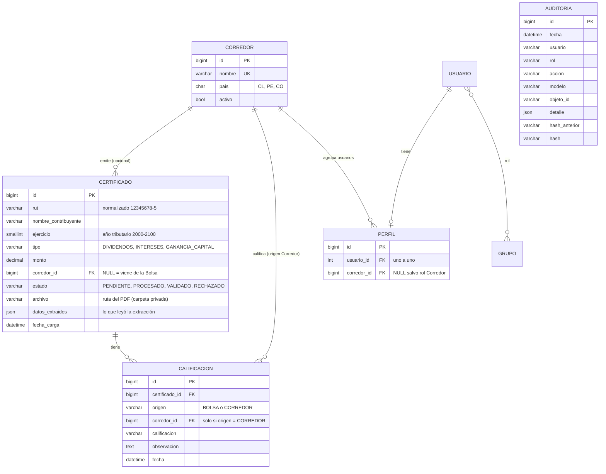
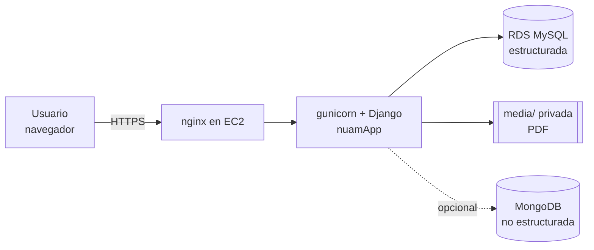

# Arquitectura y base de datos de NUAM

## 1. Modelo de datos (entidades y relaciones)



**Integridad**

| Regla | Dónde se aplica |
|---|---|
| Claves primarias en todas las tablas; claves foráneas con `on_delete=PROTECT` | `models.py`: no se puede borrar un corredor con certificados ni un certificado con calificaciones |
| Un certificado por RUT + año + tipo | `UniqueConstraint('certificado_unico')` |
| Un perfil por usuario | `OneToOneField` |
| RUT válido (módulo 11), año 2000-2100, monto ≥ 0 | validadores del modelo |
| `AUDITORIA` solo se agrega, nunca se edita ni borra | `AuditoriaQuerySet`, `save()` y `delete()` bloqueados + hash encadenado |

La tabla `AUDITORIA` no tiene claves foráneas a propósito: el nombre del usuario y la descripción del registro se guardan como texto para que sigan existiendo aunque el usuario o el registro se eliminen.

## 2. Bases estructuradas y no estructuradas

| Tipo | Tecnología | Qué guarda | Por qué |
|---|---|---|---|
| Estructurada | **MySQL** (SQLite solo para pruebas rápidas) | corredores, certificados, calificaciones, usuarios, auditoría | datos con esquema fijo, relaciones e integridad referencial |
| No estructurada | **MongoDB** (opcional, variable `MONGO_URI`) | colección `extracciones`: texto completo del PDF + campos reconocidos | cada certificado puede tener formato distinto (país, año), un esquema fijo no calza |

Funcionamiento: al procesar un PDF, el mismo documento JSON queda en `Certificado.datos_extraidos` (siempre) y se inserta además en MongoDB si está configurado (`almacen.py`). Si MongoDB no responde, la carga **no falla**: se anota el error en el log y se sigue. Ejemplo de documento:

```json
{
  "certificado_id": 17, "archivo": "cert_dividendos_2025.pdf",
  "campos": {"rut": "12345678-5", "nombre": "Ana Pérez", "ejercicio": 2025, "tipo": "DIVIDENDOS", "monto": "1250000"},
  "texto": "CERTIFICADO DE DIVIDENDOS\nAño Tributario: 2025\n...", "fecha": "2026-10-09T18:30:00Z"
}
```

Para probarlo: `pip install pymongo`, `set MONGO_URI=mongodb://localhost:27017` y cargar un PDF en *Carga masiva*; luego en `mongosh`: `use nuam; db.extracciones.find()`.

## 3. Tecnologías y su justificación

| Tecnología | Uso | Justificación |
|---|---|---|
| Python + **Django 5.2/6.0** | aplicación web | autenticación, ORM, formularios, protección CSRF/XSS y administración incluidos; reduce código propio en zonas sensibles |
| **MySQL** + PyMySQL (en **AWS RDS**) | base estructurada | motor relacional estándar; RDS entrega la base administrada, respaldos y aislamiento de red; transacciones para la bitácora |
| **AWS EC2** + Nginx + gunicorn | servidor de la aplicación | servicio de AWS pedido en el curso; gunicorn ejecuta Django y Nginx recibe el tráfico y limita el tamaño de subida |
| **MongoDB** (opcional) | base no estructurada | documentos con forma variable (texto extraído) |
| **pypdf** | lectura de PDF | biblioteca pura de Python, sin servicios externos; permite extracción por reglas (los certificados son solo dos formatos oficiales) |
| Expresiones regulares (`extractor.py`) | extracción de datos | más simple, auditable y barata que IA para formatos fijos |
| **Bootstrap 5** | interfaz | diseño consistente y responsive sin CSS propio |
| **DataTables** | tablas | búsqueda, orden y exportación (Excel, CSV, PDF, imprimir) |
| Grupos de Django | roles | RBAC probado; las reglas están en un solo archivo (`permisos.py`) |
| Django test runner | pruebas | integrado, usa base de datos temporal |

**Pensando en el futuro (escalabilidad):** la aplicación no guarda estado en memoria salvo el contador de intentos de login (ver `SEGURIDAD.md`); se puede poner detrás de un balanceador con varios procesos si ese contador pasa a Redis. Los PDF pueden migrar a almacenamiento de objetos (S3 o similar) cambiando solo la configuración `STORAGES`. La extracción se puede mover a una cola de tareas (Celery) si el volumen crece.

## 4. Vistas 4+1 (resumen técnico del proyecto)

Para el informe, las cinco vistas se corresponden con esto:

| Vista | Contenido en este proyecto |
|---|---|
| **Lógica** | Modelos `Corredor`, `Certificado`, `Calificacion`, `Perfil`, `Auditoria` y sus relaciones (diagrama de la sección 1) |
| **Desarrollo** | Un proyecto Django (`nuamProyecto`) con una app (`nuamApp`): `models.py` datos, `views.py` casos de uso, `forms.py` validación, `permisos.py` autorización, `auditoria.py` bitácora, `extractor.py` lectura de PDF, `almacen.py` MongoDB, `templates/` interfaz |
| **Procesos** | Flujo de carga: subir PDF → validar firma y tamaño → extraer texto → reconocer campos → validar RUT/duplicado → guardar (`PROCESADO`) → registrar en bitácora → copiar documento a MongoDB. Un archivo con error no detiene a los demás |
| **Física** | Desplegado en **AWS**: navegador → Elastic IP → **EC2** (Nginx + gunicorn + Django) → **RDS MySQL** privado (solo accesible desde el Security Group de la EC2, conexión cifrada); carpeta privada `media/` para PDF en el disco de la instancia; MongoDB opcional. Detalle y diagrama en [`DESPLIEGUE_AWS.md`](DESPLIEGUE_AWS.md) |
| **Escenarios** | Las historias de usuario del informe, p. ej. «carga masiva», «prioridad del corredor sobre la Bolsa», «trazabilidad»; cada una tiene su prueba en `tests.py` |


