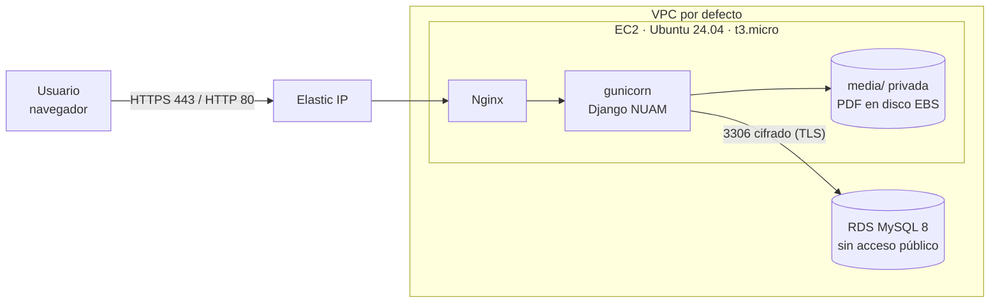

# Despliegue de NUAM en AWS (AWS Academy – Learner Lab)

Arquitectura: **una instancia EC2** (Nginx + gunicorn + Django) y **una base RDS MySQL** privada.



| Recurso | Configuración | Por qué |
|---|---|---|
| Security Group de EC2 (`nuam-web`) | entrada 22 (solo tu IP), 80 y 443 (todos) | solo se expone lo necesario |
| Security Group de RDS (`nuam-db`) | entrada 3306 **solo desde `nuam-web`** | la base no es alcanzable desde Internet |
| RDS | MySQL 8.0, `db.t3.micro`, **Public access = No**, sin Multi-AZ | mínimo privilegio y menor costo |
| Variables de entorno | `/etc/nuam.env` (permisos 600) | ninguna clave está en el código |

> Esta guía está escrita según cómo funciona AWS Academy normalmente, pero **no pude probarla en tu laboratorio**. Los nombres de las pantallas de AWS cambian de vez en cuando; si algo no coincide, la idea de cada paso sigue siendo la misma.

## Antes de empezar (particularidades del Learner Lab)

- Entra por AWS Academy → tu curso → **Learner Lab** → **Start Lab**; cuando el círculo esté verde, pulsa **AWS** para abrir la consola. Trabaja en la región que te muestra (normalmente `us-east-1`, Norte de Virginia).
- La sesión dura unas horas. Al terminar, **EC2 y RDS se detienen** (los datos se conservan). Al volver a iniciar el laboratorio hay que **encenderlos de nuevo**. La IP pública de EC2 cambia al reiniciar, por eso se usa una **Elastic IP** (paso 3).
- No puedes crear usuarios IAM. No hace falta: esta arquitectura no los usa.
- Hay un presupuesto limitado. Revisa el panel del laboratorio y **elimina RDS y la Elastic IP cuando termines** (sección 9).
- Para la clave de acceso SSH puedes usar la que ofrece el laboratorio (`vockey`, descargable como `labsuser.pem` desde *AWS Details*) o crear una propia al lanzar la instancia.

## 1. Preparar los Security Groups

EC2 → **Security Groups** → *Create*:
1. `nuam-web`: reglas de entrada **SSH 22** desde *My IP*, **HTTP 80** y **HTTPS 443** desde `0.0.0.0/0`.
2. `nuam-db`: regla de entrada **MySQL/Aurora 3306** con origen = el Security Group `nuam-web` (se elige el grupo, no una IP).

## 2. Lanzar la instancia EC2

EC2 → **Launch instance**: nombre `nuam-web` · imagen **Ubuntu Server 24.04** · tipo **t3.micro** (o `t2.micro`) · tu clave SSH · red por defecto con *Auto-assign public IP* · Security Group `nuam-web` · disco 16 GB.

## 3. Elastic IP (IP fija)

EC2 → **Elastic IPs** → *Allocate* → *Associate* con `nuam-web`. Anota esa IP: es la dirección de tu sistema.

## 4. Crear la base de datos RDS

RDS → **Create database** → *Standard create*:
- Motor **MySQL 8.0** · plantilla **Dev/Test** (o la más económica que permita el laboratorio) · **sin Multi-AZ**.
- Identificador `nuam-db` · usuario `admin` · contraseña propia (guárdala).
- Clase `db.t3.micro` · almacenamiento 20 GB.
- Conectividad: misma VPC · **Public access: No** · Security Group `nuam-db`.
- En *Additional configuration*: **Initial database name = `nuam`**. Desactiva monitoreo mejorado y Performance Insights si el laboratorio los bloquea.

Cuando termine de crearse (unos minutos), copia el **Endpoint** (`nuam-db.xxxx.us-east-1.rds.amazonaws.com`).

## 5. Entrar al servidor e instalar

Conéctate desde EC2 → *Connect* → **EC2 Instance Connect** (abre una terminal en el navegador) o por SSH:

```bash
ssh -i labsuser.pem ubuntu@<ELASTIC_IP>
```

Sube el proyecto desde tu computador (en otra terminal, en la carpeta donde está el zip):

```bash
scp -i labsuser.pem nuamProyecto.zip ubuntu@<ELASTIC_IP>:~
```

En el servidor:

```bash
sudo apt update && sudo apt install -y python3-venv nginx unzip
unzip nuamProyecto.zip && cd nuamProyecto
python3 -m venv venv && source venv/bin/activate
pip install -r requirements.txt
```

## 6. Configurar variables de entorno y conexión cifrada a RDS

```bash
# Certificado de AWS para conectar a RDS con TLS
sudo wget -O /etc/ssl/rds-global-bundle.pem https://truststore.pki.rds.amazonaws.com/global/global-bundle.pem

# Variables de entorno
sudo cp deploy/nuam.env.ejemplo /etc/nuam.env
sudo nano /etc/nuam.env          # completar: clave secreta, IP/dominio, endpoint de RDS, contraseña
sudo chown root:root /etc/nuam.env && sudo chmod 600 /etc/nuam.env
```

Clave secreta: `python3 -c "import secrets; print(secrets.token_urlsafe(50))"`.

## 7. Preparar la aplicación

Las variables de `/etc/nuam.env` las lee systemd; para los comandos de Django se cargan en la terminal:

```bash
cd ~/nuamProyecto && source venv/bin/activate
set -a; source <(sudo cat /etc/nuam.env); set +a
python manage.py migrate            # crea las tablas y los 4 roles
python manage.py collectstatic --noinput
python manage.py createsuperuser    # será el Administrador
python manage.py check --deploy     # revisión de seguridad: no debe mostrar errores
```

> `cargar_demo` **no funciona en producción** a propósito (crea usuarios con clave conocida). Los usuarios de cada rol se crean en `https://<tu-sitio>/admin/` → *Usuarios* (se asigna el **grupo**: Analista, Corredor o Auditor; el rol Corredor necesita además su corredor en el bloque *Perfil*).

## 8. Dejarlo funcionando (gunicorn + Nginx)

```bash
sudo cp deploy/nuam.service /etc/systemd/system/nuam.service
sudo systemctl daemon-reload && sudo systemctl enable --now nuam
sudo systemctl status nuam                         # debe decir "active (running)"

sudo cp deploy/nginx_nuam.conf /etc/nginx/sites-available/nuam
sudo ln -sf /etc/nginx/sites-available/nuam /etc/nginx/sites-enabled/nuam
sudo rm -f /etc/nginx/sites-enabled/default
sudo nginx -t && sudo systemctl reload nginx
```

Prueba: `curl -I http://localhost` desde el servidor debe responder (una redirección a `/ingresar/` o a HTTPS es normal).

### HTTPS: dos caminos

**A) Con HTTPS (recomendado, y lo que pide la rúbrica de seguridad).** Necesitas un nombre de dominio. Uno gratis: crea un subdominio en <https://www.duckdns.org> apuntando a tu Elastic IP. Luego:

```bash
sudo apt install -y certbot python3-certbot-nginx
sudo certbot --nginx -d nuam-tuNombre.duckdns.org
```

En `/etc/nuam.env` deja `DJANGO_HTTPS=1`, pon el dominio en `DJANGO_ALLOWED_HOSTS` y `https://nuam-tuNombre.duckdns.org` en `DJANGO_CSRF_TRUSTED_ORIGINS`, y reinicia: `sudo systemctl restart nuam`. Certbot renueva el certificado solo.

**B) Solo demostración por IP (sin certificado).** En `/etc/nuam.env`: `DJANGO_HTTPS=0`, `DJANGO_CSRF_TRUSTED_ORIGINS=http://<ELASTIC_IP>`, y `sudo systemctl restart nuam`. Las cookies viajan sin cifrar: **no uses datos reales** y aclara esa limitación en el informe.

## 9. Al terminar la sesión del laboratorio

- Al **iniciar** el laboratorio otra vez: enciende `nuam-web` y `nuam-db` (EC2 y RDS). Gracias a la Elastic IP la dirección no cambia; gunicorn y Nginx arrancan solos.
- Al **terminar el curso**: elimina RDS (puedes dejar un *snapshot* final como respaldo), la instancia EC2 y **libera la Elastic IP** (una IP pública sin usar cuesta).

## 10. Problemas frecuentes

| Síntoma | Causa probable | Solución |
|---|---|---|
| `502 Bad Gateway` | gunicorn no está corriendo | `sudo systemctl status nuam` y `sudo journalctl -u nuam -n 50` |
| `400 Bad Request` | la IP o dominio no está en `DJANGO_ALLOWED_HOSTS` | agregarlo en `/etc/nuam.env` y reiniciar `nuam` |
| «Verificación CSRF fallida» al ingresar | falta `DJANGO_CSRF_TRUSTED_ORIGINS` o el esquema (`http://` / `https://`) no coincide | corregirlo y reiniciar |
| Al entrar por `http://` te manda a un `https://` que no carga | `DJANGO_HTTPS=1` sin certificado | usar el camino A o poner `DJANGO_HTTPS=0` (solo demo) |
| `413 Request Entity Too Large` al subir PDF | falta `client_max_body_size` en Nginx | usar el archivo `deploy/nginx_nuam.conf` |
| `migrate` tarda y falla (`Can't connect to MySQL`) | Security Group de RDS o endpoint incorrecto | revisar que `nuam-db` acepte 3306 desde `nuam-web` y el endpoint en `DB_HOST` |
| `SSL connection error` hacia RDS | falta el certificado o la ruta de `DB_SSL_CA` es incorrecta | repetir el paso 6 o quitar `DB_SSL_CA` para probar |
| El panel `/admin/` se ve sin estilos | falta `collectstatic` | `python manage.py collectstatic --noinput` y reiniciar `nuam` |
| La IP de la bitácora sale `127.0.0.1` | falta `DJANGO_PROXY_CONFIABLE=1` | agregarlo y reiniciar |

## 11. Qué capturar para el informe (evidencia)

1. Consola de EC2 con la instancia *running* y su Elastic IP.
2. Los dos Security Groups con sus reglas (la base solo acepta desde `nuam-web`).
3. RDS en estado *Available* con *Public access: No*.
4. El sistema abierto en el navegador desde la dirección pública (idealmente con el candado de HTTPS).
5. Una carga masiva de PDF y la pantalla de Auditoría funcionando en AWS.
6. `sudo systemctl status nuam` y `python manage.py check --deploy` sin errores.

## 12. Mejoras futuras (para mencionar, no implementadas)

Guardar los PDF en **S3** (con `django-storages`), usar **Application Load Balancer + ACM** para el certificado, un **Auto Scaling Group** con varias instancias (entonces el contador de intentos de login debe pasar a **ElastiCache/Redis**), **Multi-AZ** en RDS, respaldos automáticos y **CloudWatch** para métricas y alarmas.
